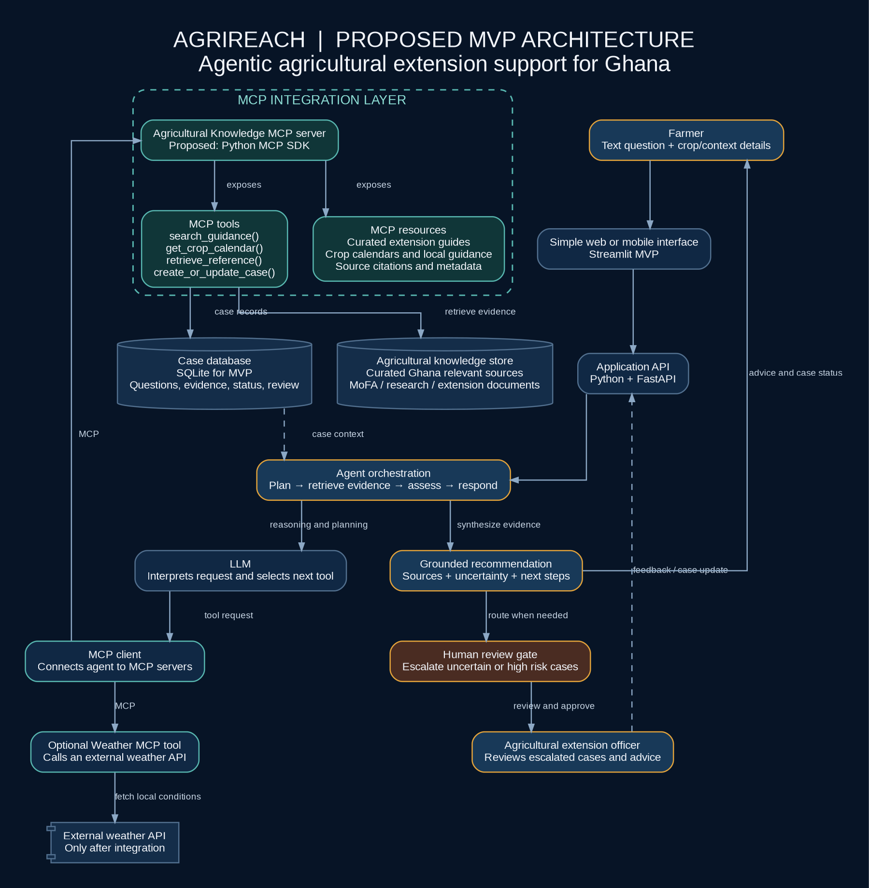

# AgriReach

**An MCP enabled agricultural extension agent for Ghana**

> **Build status (13 Oct 2026):** a working MVP runs locally. The MCP server, LangGraph agent, case database, officer gate, API, UI and tests have been run and verified. LLM drafting has been run with the open-weights model `mistralai/mistral-small-3.2-24b-instruct` via OpenRouter (see EVALS.md, which includes one real LLM failure). Tests run in offline stub mode. Nothing is deployed. See the status table below and [EVALS.md](EVALS.md).

## Problem statement

Smallholder farmers in Ghana can struggle to access timely, reliable agricultural guidance. Agricultural extension officers serve many farmers across dispersed communities, making it difficult to respond promptly to every question about planting, crop management, pest and disease concerns, and weather risks. Delayed or unreliable guidance can contribute to poor decisions, crop losses, and lower productivity.

## Solution overview

AgriReach is designed to help agricultural extension officers handle routine farmer enquiries more efficiently. A farmer submits a question. The agent identifies missing context, retrieves relevant guidance from curated agricultural references through tools, synthesises a draft advisory with its evidence, and places it in a review queue. A named extension officer must approve every advisory before it reaches a farmer. Uncertain or high-risk cases are flagged as urgent, but no case skips review. The agent should state uncertainty rather than guess.

The initial scope is a narrow soybean advisory workflow in Ghana; on 25 Oct 2026 a small set of verified Northern Ghana maize passages and the Ghana maize aflatoxin limit were added for the field-evidence evals, then MoFA's and IITA's maize planting windows for every agroecological zone, with guidance matched to the farmer's zone. Questions about other crops go straight to the officer. A local MVP runs with an open-weights model or in offline stub mode (see status below); nothing is deployed.

## Project objectives

These are the objectives for the MVP. Stub-mode evals for several of them are recorded in [EVALS.md](EVALS.md); LLM drafting and field validation are still outstanding.

- Help extension officers handle routine farmer enquiries more efficiently, while keeping a named officer responsible for approving every advisory.
- Ground every response in curated, Ghana-relevant agricultural references and show the sources used.
- Ask for missing context, and state uncertainty instead of guessing.
- Route every draft advisory to a human extension officer for approval, and flag insufficient, conflicting, or high-risk cases as urgent.
- Record case status and review outcomes for traceability.
- Start with a narrow soybean advisory workflow, and expand only after it has been evaluated.

## Target users

- Smallholder farmers seeking practical crop guidance.
- Agricultural extension officers who review cases and support farmers.
- Agricultural organisations that coordinate extension services.

## African context

The project focuses on Ghana's smallholder farming context, where agricultural advice must be practical, understandable, relevant to the local crop and season, and usable where connectivity or access to specialists may be limited. The first prototype will use a limited, curated knowledge set rather than claim nationwide coverage.

## Proposed workflow

This is the workflow the local MVP implements (stub drafting; officer gate enforced). The full version is in [the workflow document](docs/workflow.md).

1. A farmer submits a question and selects the crop and locality if known.
2. The agent checks whether it has enough context and, if needed, asks a short clarifying question.
3. The agent retrieves relevant guidance and source details through MCP tools.
4. It drafts a plain-language advisory that separates source-supported information from uncertainty.
5. Every draft goes into the officer review queue. Insufficient or conflicting evidence, or a high-risk case, marks it as urgent. Risk sets priority only and never bypasses review.
6. A named extension officer approves, edits, rejects, or requests more information. Only approved advice reaches the farmer.
7. The outcome, approver, and status are recorded so that follow-up can be tracked.

## Architecture



Flow as built (MVP; step 2 uses rules, and the LLM only writes the draft):

1. A farmer submits a question through a lightweight web interface.
2. A Python agent uses an LLM to interpret the request and identify missing information.
3. An MCP client calls tools exposed by a dedicated agricultural knowledge MCP server.
4. Tools retrieve relevant extension guidance and source metadata. A weather tool may be added if a suitable source is verified.
5. The agent produces a grounded draft advisory with source references and uncertainty notes.
6. Every draft is queued for a named extension officer to approve. Uncertain, conflicting, or high-impact cases go to the urgent queue. Nothing reaches the farmer without approval.
7. Case status and review outcomes are recorded for traceability.

See the one-page [ARCHITECTURE.md](ARCHITECTURE.md), [the detailed architecture](docs/architecture.md), and [MCP design](docs/mcp-design.md).

## Setup and installation instructions

Requires Python 3.11+ (tested on 3.13). From a clean clone:

```bash
./run.sh          # creates .venv, installs pinned deps, starts API on :8000 and UI on :8501
./run.sh test     # runs the pytest suite
# or: make run / make test  (thin wrappers around run.sh)
```

To use a model, copy `.env.example` to `.env` and set `LLM_BASE_URL`, `LLM_MODEL` and `LLM_API_KEY` for any OpenAI-compatible endpoint serving an open-weights model. If these are left empty, the app runs in a clearly labelled OFFLINE STUB mode. Never commit `.env`.

## Usage instructions

- UI: open http://127.0.0.1:8501. On the **Farmer** tab, ask a question; you get a case number. On the **Extension officer** tab, enter your name, review urgent cases first (with their reasons, sources and tool-call log), then edit, approve, reject or request info. The farmer can only see an answer after it is approved.
- CLI: `PYTHONPATH=src .venv/bin/python -m agrireach.agent "When should I harvest soybean in Tamale?"`
- API: `POST /ask`, `GET /officer/queue`, `POST /officer/cases/{id}/decision`, `GET /farmer/cases/{id}`. `POST /cases/{id}/release` returns 409 unless an officer has approved the case.

## Technology stack

Verified in this build: Python 3.13, official MCP Python SDK (`mcp` 1.30, FastMCP, stdio), LangGraph 1.2, `mcp-server-fetch` (third-party reference MCP server), SQLite, FastAPI, Streamlit, pytest. The OpenAI-compatible client (`openai` package) has been run against `mistralai/mistral-small-3.2-24b-instruct` (open weights) via OpenRouter.

## Agent architecture

A LangGraph state graph (`src/agrireach/agent.py`): `intake` (crop/region detection, risk terms, opens a `draft` case) → either `clarify` (end) or `retrieve` (MCP: `search_guidance`, `retrieve_reference` for each hit, `get_zone_planting_guidance` for planting questions, `get_recent_rainfall` for planting and top-dressing questions, `get_crop_calendar`; guidance for other agroecological zones is dropped when the farmer's zone has its own, otherwise kept with a caution, an urgent reason and `zone_mismatch`; conflict and risk flags) → `check_sources` (third-party fetch MCP server checks the cited source pages are reachable) → `write` (LLM or stub draft, then the code citation check below) → `file_case` (MCP: `create_or_update_case` to `pending_review`, urgent or routine) → end. The graph has no node that can approve or release. Intake and routing are rule-based; the LLM is only used to word the draft.

## Citation check

Before a draft is filed for the officer, `src/agrireach/citation_check.py` (plain code, no model) checks it against the retrieved passages:

- Every number (with its unit if given, e.g. `2.5 cm`, `50kg`, `1,000`, `two weeks`) and every date (`15 March`, `March 15`, `mid-June`, `late July`) must appear in a passage cited for it. Figures attach to the next citation bracket; a figure with no citation, or a citation to a passage that was not retrieved, fails.
- A figure's limit counts too: "up to 5 cm" and "not deeper than 5 cm" are upper limits, "at least 50 kg" a lower limit, otherwise a plain value. A draft that swaps limits ("up to 5 cm but not deeper than 3 cm" for "recommended 3 cm; not deeper than 5 cm") or states a maximum as the recommendation fails.
- When code has detected that sources disagree (same claim, different sources), each source's figure must be stated with that source's own citation. A draft that merges the sources into one range or cites both for one figure fails. That was the task 10/11 failure.
- If the model's draft fails, it is regenerated once with the list of problems. If it fails again, the officer gets the verbatim passages instead, the case is marked urgent with `citation check failed: ...`, and the rejected draft is kept in the result for review. A failing draft is never filed as if it were clean, and nothing is released without officer approval either way.
- Retrieval is conflict-complete: if any passage on a claim is retrieved, every other source's passage on that claim is retrieved too, so a disagreement can't be hidden by ranking.

Sentences without figures are checked by `src/agrireach/claim_check.py`, through the same regenerate-then-fallback path:

- Named sources (code): a sentence that names a source ("IITA says…") must cite a passage from it.
- Agreement claims (code): "both sources agree…" must cite at least two sources, each of which backs the sentence on its own (its figures, or at least 60% of the sentence's content words). Calling a disagreement that code detected "agreement" fails.
- Support (code): a cited sentence must share at least one content word with the passages it cites. This catches an unrelated citation; it can't tell a paraphrase from a contradiction.
- Judge: a second model (`AGRIREACH_JUDGE_MODEL`, default `meta-llama/llama-3.3-70b-instruct`; use one different from the drafter) asked whether each sentence of a model draft is supported, including uncited sentences and lines addressed to the officer. It is always on for model drafts and uses the same `LLM_BASE_URL` and key, so each draft costs one extra model call. It fails closed: if the judge can't run or gives no verdict, the draft is rejected, the error is recorded on the case, and the officer gets the verbatim passages. Offline stub drafts are not judged.

Measured (EVALS "Latest"): on 69 recorded real drafts, the code layers reject 0 of 59 clean drafts and catch 5 known defects; the judge catches 5 more. Before place names were masked from the judge it also rejected 8 of 59 clean drafts (13.6%, mostly a recurring Kumasi draft); with masking and a prompt rule for partial statements it rejects 1 of 59. In live runs, false rejects caused 0 of 34 fallbacks with the judge off, 2 of 47 with it on before masking, and 0 of 51 with it on after (three runs).

Limits: figures are matched by a fixed word list next to each number. Uncited sentences are checked lexically against the passages the draft cites, except notes and lines about the reply's language, and all of them go to the judge. Without a judge (offline stub mode), an unsupported sentence that shares words with its passage passes (e.g. "mouldy maize is harmful to humans and animals" citing the aflatoxin-limit passage). False positives fail closed: the officer gets the verbatim passages and an urgent flag. See EVALS.

## MCP implementation

`src/agrireach/mcp_server.py` is our own MCP server, built with the official Python SDK (FastMCP over stdio). The agent connects to it and to `mcp-server-fetch` as MCP clients. Every tool call is logged to the `tool_log` table, with actor, arguments, result summary and ok/blocked.

## MCP tools and servers

| Component | Purpose | Status |
|---|---|---|
| AgriReach Knowledge MCP server (ours) | Curated corpus + case actions | **Working** (tested over MCP stdio) |
| `search_guidance` | Search curated verbatim passages (soybean, maize) | **Working** |
| `get_crop_calendar` | Cited calendar activities; empty when no local reference | **Working** |
| `get_zone_planting_guidance` | Planting-window rows and national planting rules for the zone of a Ghana place, for the season asked (read-only) | **Working** (tested over MCP stdio) |
| `get_recent_rainfall` | Last 30 days of daily rainfall for a district (Open-Meteo model estimate, CC BY 4.0), rain days, missing days, provider, licence, retrieval time; cached; offline says "rainfall unavailable". Attached to planting and top-dressing cases as a cited record for the officer, plus an officer-only line with the figures; with only a region or no place, the officer line says why there is no record and to ask the farmer for the district. Never says onset has been reached or "rains are good, plant now" (draft and SMS are both checked) | **Working** (recorded-response tests; one live run on 25 Oct 2026, [docs/rainfall-live-2026-10-25.md](docs/rainfall-live-2026-10-25.md)) |
| `retrieve_reference` | One passage + source metadata; errors on unknown id | **Working** |
| `create_or_update_case` (acting tool) | File case as `draft`/`pending_review` only; `approved` is rejected. Returns the case's `created_at`, which the agent puts next to the cited planting windows as an officer-only fact ("Question received 25 Oct 2026. Windows cited: … The date is outside the cited windows."); no next window is inferred | **Working** |
| `mcp-server-fetch` (third-party, not ours) | Check that cited source pages are reachable | **Working** (needs `--allow-private-ips` on networks with fake-IP DNS; runs with `raw=true` because its HTML extractor failed on Node 20) |
| Weather tool | Forecasts | Not built |

**Status of other parts**

| Part | Status |
|---|---|
| LangGraph agent, stub drafting | **Working** |
| LLM drafting via open-weights model | **Working** with Mistral Small 3.2 24B (open weights) via OpenRouter; every draft passes through the citation check. Known gap: sentences without figures are not checked (see EVALS task 12, runs C and E) |
| Citation check (dates, numbers and their limits vs cited passage) | **Working** (unit tests + real-model eval runs, 23 Oct; regeneration and fallback both exercised in run D) |
| Twi questions | **Partial**: detected and routed to the officer as urgent with a keyword gloss; no translation and no Twi replies |
| SQLite cases + officer gate + release block | **Working** (tests) |
| FastAPI + Streamlit | **Working** locally (API calls verified; UI page served, HTTP 200) |
| One-command run `./run.sh` from clean clone | **Working** (verified) |
| Deployment / public demo | Not done |

## Human in the loop workflow

No advice ever reaches a farmer without approval from a named extension officer. The agent drafts, and the officer decides. Every draft advisory enters a review queue. Risk and uncertainty only set its priority: cases where sources conflict, the location or crop context is missing, confidence is low, or advice could have material consequences go to the urgent queue, and all other cases go to the routine queue. The extension officer can review the original question, retrieved references, draft advisory, and reason for any urgent flag. The officer can approve, edit, reject, or request more information, and each decision is recorded with the officer's name and a timestamp. Approval covers the exact text the farmer receives: the officer sees the cited draft and a short plain-language farmer version, can edit either, and the approved farmer text is what is sent. The agent must not autonomously prescribe hazardous chemical use or present a suspected plant disease as a confirmed diagnosis.

## Development roadmap

Done (13 Oct): verified corpus, MCP server, LangGraph agent, case DB and gate, API/UI, tests, evals in stub mode and with an open-weights model.
Done (23 Oct): citation check for dates and numbers, conflict-complete retrieval, Twi detection and officer routing (EVALS tasks 10-12).
Done (23 Oct, review): the check also compares each figure's limit ("not deeper than", "up to", "at least"), so swapped bounds fail.
Done (25 Oct): 14 field-evidence evals (EVALS F1-F14) from public reports, verified maize and aflatoxin passages, routing of uncovered crops and contact requests to the officer.
Done (25 Oct): claim check for sentences without figures (named sources, agreement claims, lexical support) and an optional, separate judge model, with measured false-reject rates.
Done (25 Oct, local only): voice-note channel. A voice note or text with a sender id goes through local speech-to-text (faster-whisper) into a case; the officer-approved answer goes back through the same channel as text, optionally with a Piper voice. A local simulator (CLI and Streamlit tab) stands in for the phone. A WhatsApp Cloud API adapter exists as code only, off by default and never registered or deployed. See [docs/voice-channel.md](docs/voice-channel.md) and [docs/whatsapp-setup.md](docs/whatsapp-setup.md).
Done (25 Oct, local only): an SMS adapter for Africa's Talking, code only and off by default. There is no account, it has only been tested against mocked responses, and it has never sent or received a real SMS. Over-long texts are refused for the officer to shorten, never cut. See [docs/sms-setup.md](docs/sms-setup.md).
Done (25 Oct, local only): farmer-facing reply (the officer approves the exact plain text that is sent; citations stay in the officer view), place-name confirm-back after speech-to-text using a gazetteer of Ghana's 261 districts, first-contact consent, STOP and a retention purge.

Next: test speech-to-text on real, consented voice notes, record the demo video, then consider a weather tool and real Twi support with native-speaker review.

## Limitations

- No public deployment yet; the MVP runs locally only.
- Coverage is limited to the curated documents: Northern Ghana soybean and maize, maize planting windows for every agroecological zone, plus the national maize aflatoxin limit. The district-to-zone map (`data/zones.json`) is approximate and not yet checked by an extension officer.
- Rainfall is a model estimate for one point per district (Open-Meteo), not a gauge reading, and the guides give no rainfall amount for onset, so AgriReach shows the record and the officer decides. Open-Meteo's free API is for non-commercial use only. Other crops, prices and contact details are always passed to the officer.
- The quality of recommendations depends on the authority and freshness of source material.
- Text based advice may not be enough to diagnose a plant health issue.
- Voice notes: speech-to-text was tested on synthetic US-English clips and on 10 Ghanaian broadcast-English clips (run S1: 52.5% word error rate with Whisper "base", language mis-detected in 7/10; all 10 flagged for the officer). It is not tested on real farmer voice notes, and Whisper does not support Twi, Dagbani or Wali; such notes are flagged for the officer to listen to. Misheard place names ("Wa" -> "war") are confirmed back with the farmer, not corrected silently. The consent wording has had no legal review. The WhatsApp and SMS adapters have never sent or received a real message.
- Twi support is detection plus a keyword gloss only: AgriReach cannot translate or reply in Twi, so Twi cases go to the officer as urgent. Other local languages are not handled. Offline access and accessibility require further work.
- The citation check confirms that every date and number in a draft, and any limit on it ("up to", "not deeper than", "at least"), appears in the passage it cites. Sentences without figures get code checks (named sources, agreement claims, at least one shared word) and a judge model that fails closed; without it (offline stub mode), a sentence that shares words with its passage but says something the passage doesn't will pass.
- How often to apply counts as a dose, so a line that repeats an application ("Apply twice a week.", "Spray at 14-day intervals.") is held unless it is copied word for word from the cited source; the officer cannot acknowledge this hold. This is a word list (`instruction_policy.REPEAT`), not an understanding of the sentence, so it misses some wordings and over-holds others. It misses, for example, "Apply now and next week." and "Apply through the season." It over-holds "Apply compost each season." The judge and the officer, who approves every line, are the check on wordings it misses.
- Weather coverage and API access have not yet been verified.
- The system is decision support and does not replace qualified agricultural advice.

## Future improvements

- Validate the MVP with agricultural extension officers and farmers.
- Add carefully evaluated local language support.
- Add image based crop issue triage only after collecting suitable validation data.
- Add low bandwidth and offline friendly interaction.
- Expand beyond soybean after evaluating the first workflow.
- Add monitoring for follow up cases and referral outcomes.
- Evaluate factual grounding, escalation quality, response time, and farmer usability.

## Evaluation plan

The prototype should be evaluated on whether it retrieves relevant evidence, cites the source used, asks for missing context, abstains when evidence is insufficient, sends every draft to officer review, flags risky cases as urgent, and records a traceable case history. Results from real runs (stub and open-weights LLM) are in [EVALS.md](EVALS.md). Performance claims will only be added after tests or user evaluation support them.

## Repository structure

```text
src/agrireach/  mcp_server.py  agent.py  db.py  knowledge.py  llm.py  claim_check.py  judge.py  voice_script.py  api.py  ui.py
src/agrireach/channels/  base.py  service.py  stt.py  tts.py  simulator.py  whatsapp.py  sms.py (both code only, off by default)
data/knowledge.json   verbatim cited passages (APNI/CSIR-SARI 2023 soybean and maize guides, IITA SSPiNG 2022, Agbetiameh et al. 2018)
evals/                field_evidence.json: eval questions F1-F14 with sources and expected routing
tests/                pytest suite (offline stub mode)
scripts/              run_evals.py, verify_corpus.py
docs/                 architecture, MCP design, workflow, data sources, eval-run.txt
run.sh  Makefile  requirements.txt  .env.example  EVALS.md  ARCHITECTURE.md
```

## Build window integrity

The design documents were prepared earlier. The application code was written from 13 October 2026, after the organiser confirmed the submission deadline (15 Oct 2026, 23:59 EAT). Commit timestamps are real.

## Licence

This project is released under the MIT License (see [LICENSE](LICENSE)). Do not add third party datasets or documents unless their licence permits the intended use.
